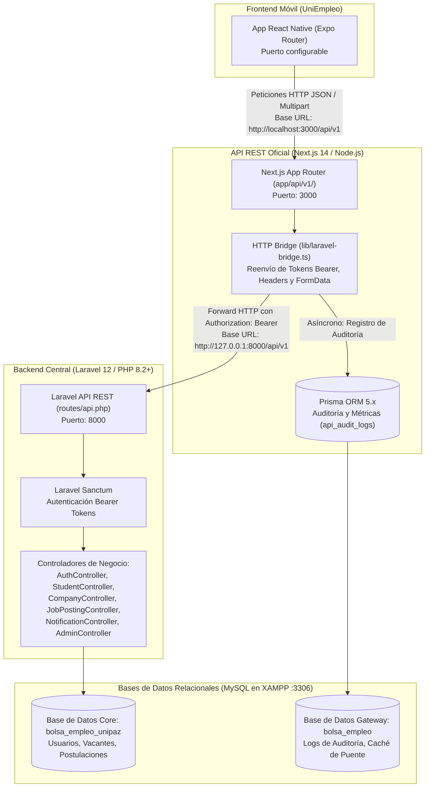

# ARQUITECTURA DE INTEGRACIÓN: API REST NEXT.JS -> LARAVEL 12
## Bolsa de Empleo UNIPAZ (UniEmpleo)

Este documento detalla la arquitectura oficial del backend implementado para conectar la aplicación móvil **UniEmpleo** (React Native / Expo) con el backend central en **Laravel 12** de Darwin García, utilizando **Next.js (App Router)** como **API Gateway / Capa Puente REST** y **Prisma ORM** como motor de auditoría y persistencia de métricas.

---

## 1. Diagrama de Arquitectura de la Solución

---

## 2. Roles y Responsabilidades Técnicas

| Componente | Rol en la Arquitectura | Responsabilidad Principal |
|---|---|---|
| **UniEmpleo (React Native)** | Cliente Móvil | Consume la API REST expuesta en `http://localhost:3000/api/v1`. Almacena de forma segura el Bearer Token en SecureStore. |
| **Next.js (App Router + Node.js)** | API Gateway REST Oficial | Expone los endpoints `app/api/v1/`, gestiona CORS para Expo, normaliza formatos de entrada/salida y reenvía las solicitudes al backend de Laravel mediante `lib/laravel-bridge.ts`. |
| **Prisma ORM** | Motor de Auditoría y Métricas | Registra cada petición entrante, método HTTP, código de respuesta, tiempo de respuesta en milisegundos y dirección IP en la tabla `api_audit_logs`. Cumple con el stack exigido (Next.js + Prisma ORM). |
| **Laravel 12 (Darwin García)** | Core de Lógica de Negocio | Gestiona usuarios, empresas, vacantes, postulaciones del Sprint 3, notificaciones y reglas de negocio institucionales sobre MySQL (`bolsa_empleo_unipaz`). |

---

## 3. Mapeo: Pantallas Móviles -> Endpoints Next.js -> Rutas Laravel

| Pantalla UniEmpleo | Endpoint Next.js (Puerto 3000) | Ruta Laravel (Puerto 8000) | Método | Descripción del Flujo |
|---|---|---|---|---|
| `LoginScreen` | `/api/v1/auth/login` | `/api/v1/auth/login` | POST | Valida credenciales contra Laravel y retorna el token Sanctum. |
| `RegisterStudent` | `/api/v1/auth/register/student` | `/api/v1/auth/register-student` | POST | Registra estudiante en Laravel con perfil académico inicial. |
| `RegisterCompany` | `/api/v1/auth/register/company` | `/api/v1/auth/register-company` | POST | Registra empresa en estado `pending` en Laravel. |
| `HomeScreen` | `/api/v1/jobs` | `/api/v1/jobs` | GET | Consulta catálogo de vacantes con filtros (`search`, `modality`, `location`). |
| `JobDetailScreen` | `/api/v1/jobs/[id]` | `/api/v1/jobs/{id}` | GET | Detalle de vacante e información de la empresa contratante. |
| `JobDetail` (Acción) | `/api/v1/applications` | `/api/v1/jobs/{id}/apply` | POST | Postulación de estudiante a una vacante. Evita duplicados (HTTP 422). |
| `MyApplications` | `/api/v1/applications/student` | `/api/v1/student/applications` | GET | Lista postulaciones del estudiante. **Filtra estrictamente `company_notes`.** |
| `StudentProfile` | `/api/v1/students/profile` | `/api/v1/student/profile` | GET / PUT | Consulta y actualización de datos académicos del estudiante. |
| `UploadCVScreen` | `/api/v1/students/upload-cv` | `/api/v1/student/profile/cv` | POST | Sube PDF de hoja de vida (hasta 5MB) a Laravel Storage (`public/cvs/`). |
| `CompanyStatus` | `/api/v1/companies/status` | `/api/v1/company/profile` | GET | Verifica si la empresa está aprobada para publicar ofertas. |
| `CompanyProfile` | `/api/v1/companies/profile` | `/api/v1/company/profile` | GET / PUT | Edición del perfil comercial de la empresa. |
| `CreateJobScreen` | `/api/v1/jobs` | `/api/v1/company/jobs` | POST | Publica vacante laboral (restringido a empresas con estado `approved`). |
| `CompanyJobs` | `/api/v1/jobs/[id]` | `/api/v1/company/jobs/{id}` | PUT | Modifica o pausa/reanuda vacantes de la empresa. |
| `JobApplicants` (Sprint 3) | `/api/v1/applications/job/[jobId]` | `/api/v1/company/applications?job_id={id}` | GET | Listado de postulantes a la oferta con acceso a hojas de vida y notas. |
| `ApplicantDetail` (Sprint 3) | `/api/v1/applications/[id]/status` | `/api/v1/company/applications/{id}/status` | PUT | Cambia estado (`pending`, `reviewed`, `interview`, `accepted`, `rejected`) y guarda `company_notes`. |
| `Notifications` | `/api/v1/notifications` | `/api/v1/notifications` | GET | Lista notificaciones recibidas por el usuario. |
| `Notifications` (Acción) | `/api/v1/notifications/[id]/read` | `/api/v1/notifications/{id}/read` | PUT/PATCH | Marca notificación como leída o todas (`id: 'all'`). |
| `AdminCompanies` | `/api/v1/admin/companies/pending` | `/api/v1/admin/companies?status=pending` | GET | Listado de empresas pendientes de validación por UNIPAZ. |
| `AdminApprove` | `/api/v1/admin/companies/[id]/approve` | `/api/v1/admin/companies/{id}/approve` | PUT/POST | Aprueba o rechaza empresas en el sistema central. |

---

## 4. Política de Seguridad y Privacidad (Sprint 3)

1. **Tokens Sanctum Bearer:**
   - Emitidos por Laravel Sanctum al autenticar.
   - La app móvil envía `Authorization: Bearer <token>` a Next.js (`:3000`).
   - El cliente `lib/laravel-bridge.ts` propaga el header intacto hacia Laravel (`:8000`), el cual valida los permisos por rol (`student`, `company`, `admin`).
2. **Aislamiento Estricto de `company_notes`:**
   - El campo `company_notes` de la postulación contiene anotaciones privadas de los evaluadores de la empresa.
   - En las respuestas entregadas a los estudiantes (`/api/v1/applications/student`), este campo es eliminado tanto por Laravel Resource como por la capa de transformación del Bridge en Next.js.
   - Solo la empresa propietaria de la vacante puede ver y editar este campo en `/api/v1/applications/job/[jobId]` y `/api/v1/applications/[id]/status`.
3. **Control Anti-Duplicados:**
   - La API bloquea automáticamente cualquier intento de postulación doble por parte de un estudiante a la misma oferta, respondiendo con código HTTP 422.
4. **Límite de Archivos:**
   - Los archivos de hojas de vida están limitados a formato PDF con un tamaño máximo de 5 MB.
